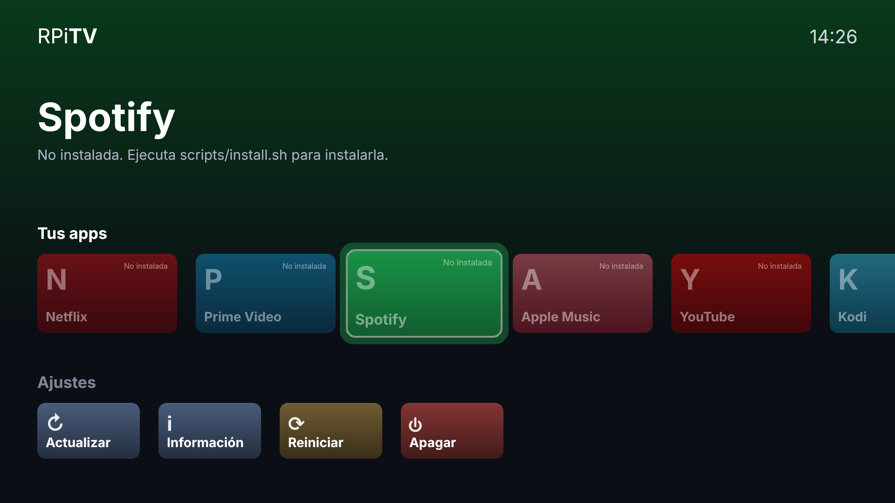

# RPi TV Box

Convierte una Raspberry Pi en una "caja de TV": la conectas a la tele por HDMI,
arranca directamente en un menú de apps a pantalla completa y lo manejas todo
con el **mando de la TV** (HDMI-CEC), un mando Bluetooth/USB o un teclado.



```
 ┌───────────────────────────────────────────────────────────────┐
 │ RPiTV                                                  21:30  │
 │                                                               │
 │ Netflix                                                       │
 │ Pulsa OK para abrir                                           │
 │                                                               │
 │ Tus apps                                                      │
 │ [Netflix] [Prime Video] [Spotify] [Apple Music] [YouTube] ... │
 │ Ajustes                                                       │
 │ [Actualizar] [Información] [Reiniciar] [Apagar]               │
 └───────────────────────────────────────────────────────────────┘
```

## Cómo funciona

| Pieza | Qué es |
|---|---|
| **Lanzador** (`launcher/`) | Interfaz de TV escrita en Python + Qt Quick (QML). Muestra las apps y las abre. |
| **Kodi** | Reproductor nativo (no es un navegador). Netflix, Prime Video, YouTube y Spotify funcionan como *addons* nativos de Kodi, con DRM Widevine. |
| **Botón Inicio** | Desde cualquier app, el botón Inicio del mando (o mantener **Atrás** 2 s) cierra la app y vuelve al menú. |
| **HDMI-CEC** | La RPi se registra en la TV como reproductor: el mando de la tele mueve el menú. |
| **Spotify Connect / AirPlay** | La RPi aparece como altavoz "RPi TV" en Spotify y en el iPhone. |

### Por qué no son "las apps oficiales" de Android/Windows

Netflix, Prime Video, Spotify y Apple Music **no publican app para Linux en ARM**
(que es lo que corre una Raspberry Pi), y sus apps de Android exigen un
dispositivo certificado con DRM de hardware que la RPi no tiene. La alternativa
nativa más sólida son los addons de Kodi: son programas, no páginas web, y
reproducen con el mismo DRM (Widevine) que usan los navegadores.

| App | Cómo funciona aquí | Limitaciones |
|---|---|---|
| Netflix | Addon `plugin.video.netflix` (CastagnaIT) | Calidad máx. ~1080p (sin 4K/HDR). Requiere iniciar sesión una vez. |
| Prime Video | Addon `plugin.video.amazon-test` (Sandmann79) | Igual que Netflix. |
| YouTube | Addon oficial del repositorio de Kodi | Necesita una clave de API propia (gratis) desde hace años. |
| Spotify | Addon `plugin.audio.spotify` (glk1001) + Spotify Connect (raspotify) | Requiere Spotify Premium. |
| Apple Music | **AirPlay** desde iPhone/Mac (shairport-sync). Opcional: cliente no oficial *Sidra* | No existe app de Apple Music para la RPi; se controla desde el móvil. |
| Kodi | Kodi completo para tus vídeos, IPTV, etc. | — |

> Alternativa: existen builds no oficiales de **Android TV para RPi** (LineageOS de KonstaKANG).
> Permiten instalar APKs, pero Netflix/Prime suelen negarse a funcionar o
> limitarse a calidad baja por no estar certificadas. Por eso este proyecto usa Linux + Kodi.

## Hardware recomendado

- **Raspberry Pi 5 (4 GB)** o Raspberry Pi 4 (2 GB o más). La Pi 4 decodifica H.264 por hardware; la Pi 5 lo hace por software sin problemas a 1080p.
- Tarjeta microSD de 32 GB o más (clase A2) y fuente oficial.
- TV con HDMI-CEC (Anynet+ en Samsung, SimpLink en LG, Bravia Sync en Sony…) o un mando Bluetooth / "air mouse" USB.

## Instalación

1. Graba **Raspberry Pi OS (64-bit) con escritorio** con Raspberry Pi Imager.
2. En la RPi, abre un terminal y ejecuta:

   ```bash
   git clone https://github.com/nrpp/rpitvbox.git ~/RPITvBox
   cd ~/RPITvBox
   ./scripts/install.sh
   ```

   Opciones: `--no-airplay`, `--no-spotify-connect`.

3. Activa el inicio de sesión automático:
   `sudo raspi-config` → *System Options* → *Boot / Auto Login* → *Desktop Autologin*.
4. Reinicia (`sudo reboot`). La RPi arrancará directamente en el menú.

### Configurar los addons en Kodi (una sola vez)

El instalador descarga los repositorios en `~/rpitvbox-addons`. Con un teclado o el mando:

1. Abre **Kodi** desde el menú.
2. *Ajustes → Sistema → Add-ons* → activa **Orígenes desconocidos**.
3. *Ajustes → Servicios → Control* → comprueba que **"Permitir el control remoto
   desde aplicaciones de este sistema"** está activado (el lanzador lo usa para abrir cada addon).
4. *Add-ons → Instalar desde archivo zip* → carpeta `rpitvbox-addons`:
   - `repository.castagnait-*.zip` y luego *Instalar desde repositorio → CastagnaIT → Netflix*.
   - `repository.sandmann79*.zip` y luego *Instalar desde repositorio → Sandmann79 → Amazon VOD*.
   - `plugin.audio.spotify-*.zip` (Spotify).
   - YouTube: *Instalar desde repositorio → Kodi Add-on repository → Vídeo → YouTube*.
5. Abre Netflix y Prime una vez: Kodi te ofrecerá instalar **Widevine** (acepta) y te pedirá iniciar sesión.

Si alguna descarga falló, baja el zip a mano desde la web de cada proyecto
(CastagnaIT, Sandmann79, glk1001) y ponlo en `~/rpitvbox-addons`.

Vuelve al menú pulsando **Actualizar**: las apps instaladas dejan de mostrar "No instalada".

## Controles

| Mando | Acción |
|---|---|
| ← → | Moverse entre apps |
| ↑ ↓ | Cambiar entre "Tus apps" y "Ajustes" |
| OK / Enter | Abrir |
| Inicio | Cerrar la app abierta y volver al menú |
| Mantener Atrás 2 s | Igual que Inicio (para mandos sin botón Inicio) |

Dentro de Kodi también puedes salir con el menú de apagado de Kodi → **Salir**.

> Nota sobre CEC: mientras Kodi está abierto, Kodi toma el control del mando de la TV.
> Usa Atrás/Salir de Kodi para volver; con mandos Bluetooth/USB funciona además el botón Inicio.

## Añadir o quitar apps

Edita `config/apps.json` (o copia a `~/.config/rpitvbox/apps.json` para tu versión personal):

```json
{ "id": "disney", "name": "Disney+", "color": "#113CCF",
  "type": "kodi-addon", "addon": "plugin.video.disneyplus" }
```

Tipos:
- `kodi` – abre Kodi.
- `kodi-addon` – abre Kodi directamente en ese addon (`addon` = id del addon).
- `command` – ejecuta un programa (`command: ["programa", "arg"]`, `check` = binario a comprobar).

## Probar en un PC

```bash
python3 -m venv .venv && .venv/bin/pip install -r requirements.txt
cd launcher && RPITVBOX_WINDOWED=1 ../.venv/bin/python -m rpitvbox
```

Variables útiles: `RPITVBOX_WINDOWED=1` (ventana en vez de pantalla completa),
`RPITVBOX_CONFIG=/ruta/apps.json`, `RPITVBOX_HOME_KEYS=KEY_HOMEPAGE,KEY_F12`.

## Estructura

```
config/apps.json            apps del menú
config/kodi/                atajo de teclado para Kodi
launcher/qml/               interfaz (Main.qml, Tile.qml)
launcher/rpitvbox/          lógica: lanzar apps, botón Inicio, sistema
scripts/install.sh          instalador para la RPi
scripts/start.sh            arranque del lanzador (con reinicio automático)
scripts/cec-setup.sh        registra la RPi en HDMI-CEC
systemd/                    servicio CEC
```
